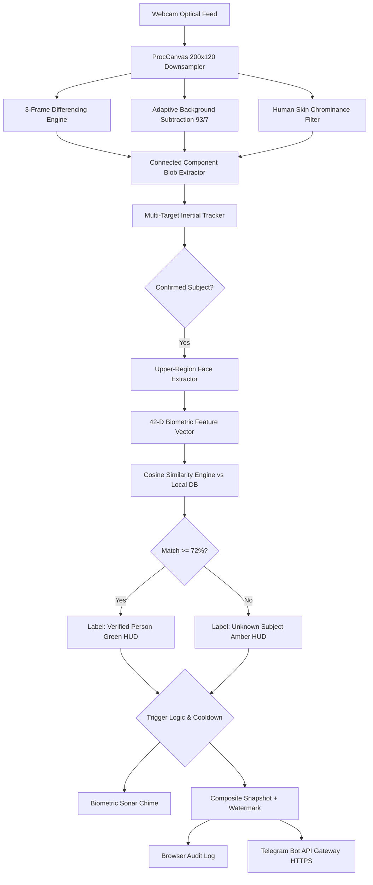

# 🛡️ MikoTim Sentinel Pro v4.0

<div align="center">


<br/>

[](LICENSE)
[](index.html)
[](index.html)
[](https://core.telegram.org/bots/api)
[](index.html)
[](index.html)
[](https://pages.github.com/)

<p align="center">
  <b>Enterprise-Grade, 100% Offline Optical Security & Person Recognition Gateway</b><br/>
  <i>سامانه جامع و هوشمند پایش تصویری، تشخیص چهره بیومتریک و کنترل تردد آفلاین</i>
</p>

[English](#-english-documentation) • [راهنمای فارسی](#-مستندات-فارسی) • [Features](#-key-features) • [Quick Start](#-quick-start) • [Telegram Guide](#-telegram-gateway--remote-commands)

</div>

---

## 📑 Table of Contents / فهرست مطالب
- [English Documentation](#-english-documentation)
  - [Key Features](#-key-features)
  - [Technical Architecture](#-technical-architecture)
  - [Face Biometric Recognition](#-face-biometric-recognition-system)
  - [Telegram Gateway & Remote Commands](#-telegram-gateway--remote-commands)
  - [Quick Start](#-quick-start)
  - [Privacy & Security](#-privacy--security)
- [مستندات فارسی](#-مستندات-فارسی)
  - [معرفی کلی](#-معرفی-پروژه)
  - [ویژگی‌های کلیدی](#-ویژگیهای-کلیدی-سیستم)
  - [هوش مصنوعی بیومتریک و تشخیص چهره](#-هوش-مصنوعی-آفلاین-و-ثبت-چهره)
  - [راهنمای راه‌اندازی ربات تلگرام](#-راهنمای-اتصال-به-تلگرام)
- [License](#-license)

---

## 🇬🇧 English Documentation

### 🌟 Key Features

- **🧠 100% Offline AI Vision Engine**: Runs entirely in client browser memory using HTML5 Canvas & TypedArrays. No external AI APIs, no cloud inference, no monthly subscriptions.
- **👤 Real-time Face Registration & Identification**: Register known personnel (employees, guards, family) with a single snapshot. Real-time 42-dimensional vector matching recognizes individuals live on camera.
- **🎯 Visual HUD & Dynamic Bounding Brackets**:
  - 🟢 **Green Brackets**: Verified registered personnel with matched name & confidence percentage (`Name: Alice (88%)`).
  - 🟡 **Amber Brackets**: Unknown / unregistered subjects (`ID #102 (76%)`).
- **📸 Smart Event Dispatch**:
  - Configurable *"Capture only when a new person enters"* filter.
  - Multi-target tracking with persistent inertial IDs across frames.
- **📲 Two-Way Telegram Integration**:
  - Instant dispatch of high-resolution incident snapshots with reticle overlay, timestamp watermark, and recognized personnel names.
  - Remote control over Telegram bot commands: `/photo`, `/status`, `/pause`, `/resume`.
- **🕒 Security Shift Scheduling**: Define operational active hours (e.g., Night Shift `23:00` to `07:00`).
- **🔲 Sensitive ROI Zones**: Interactive click-and-drag drawing to monitor specific doors, corridors, or perimeter gates while ignoring background motion.
- **⚡ Zero Setup, Single-File HTML**: Runs instantly by double-clicking `index.html` in Chrome, Edge, Firefox, or Safari, or deploy instantly via GitHub Pages.
- **🌐 Full Bilingual Support**: Toggle instantly between English (LTR) and Persian (RTL) with complete typography and layout flipping.

---

### 🏗️ Technical Architecture



---

### 🔬 Face Biometric Recognition System

MikoTim Sentinel Pro extracts an ultra-fast, lightweight **42-dimensional signature vector** directly from live canvas pixel data without requiring gigabytes of deep-learning weights:

1. **Color Signature (24 dims)**: 8-bin normalized color distribution histograms across Red, Green, and Blue channels.
2. **Spatial Gradient Mesh (16 dims)**: 4×4 spatial grid measuring luminance gradients across the facial bounding region.
3. **Chrominance Ratio (1 dim)**: Normalized human skin-tone chrominance density ($R > G > B$ and $\Delta(R, G) > 8$).
4. **Aspect Form Factor (1 dim)**: Geometric ratio of facial height to width.

**Matching Algorithm**: Normalised Cosine Similarity ($S_C$):
$$\text{Similarity}(\mathbf{A}, \mathbf{B}) = \frac{\mathbf{A} \cdot \mathbf{B}}{\|\mathbf{A}\|_2 \|\mathbf{B}\|_2}$$

Vectors with $S_C \ge 0.72$ trigger an immediate positive identification and update the subject's `lastSeen` timestamp in persistent `localStorage`.

---

### 📲 Telegram Gateway & Remote Commands

Configure your Bot Token and Destination Chat ID in the **Settings** tab. Sentinel Pro supports real-time remote commands:

| Command | Action | Description |
|---|---|---|
| `/photo` or `عکس` | Instant Snapshot | Takes an immediate camera photo and replies back on Telegram. |
| `/status` or `وضعیت` | Health Audit | Reports camera online status, capture counter, and monitoring state. |
| `/pause` or `توقف` | Standby Mode | Pauses event triggers and alert dispatches. |
| `/resume` or `ادامه` | Arm System | Resumes normal monitoring and event triggering. |

---

### 🚀 Quick Start

1. **Clone or Download**:
   ```bash
   git clone https://github.com/your-username/mikotim-sentinel-pro.git
   cd mikotim-sentinel-pro
   ```
2. **Launch**:
   Simply open `index.html` in any modern web browser (Edge, Chrome, Brave, Firefox, Safari). No `npm install`, no Python backend, no dependencies!
3. **Host on GitHub Pages (Optional)**:
   Push to your GitHub repository and enable **Settings > Pages > Deploy from branch (main)**. Your security portal will be live at `https://<username>.github.io/<repo>/`!

---

### 🔒 Privacy & Security

- **100% Client-Side**: No video frames or biometric signatures are sent to external cloud servers.
- **Zero Third-Party Trackers**: No Google Analytics, no CDN telemetry, no external cookies.
- **Direct Telegram Dispatch**: Telegram requests use direct HTTPS calls from your browser directly to `api.telegram.org`.

---

## 🇮🇷 مستندات فارسی

### 🛡️ معرفی پروژه

**میکوتیم سنتینل پرو (MikoTim Sentinel Pro v4.0)** یک پلتفرم جامع، مدرن و صنعتی برای نظارت تصویری، کنترل تردد هوشمند و تشخیص چهره بیومتریک است که **به‌صورت ۱۰۰٪ آفلاین** و بدون نیاز به اینترنت یا سرورهای خارجی در مرورگر اجرا می‌شود.

این پروژه برای محیط‌های کارگاهی، انبارها، دفاتر کار، خطوط تولید و مصارف خانگی طراحی شده است تا بدون نیاز به پرداخت هزینه‌های سنگین سرور یا نگرانی‌های امنیتی نقض حریم خصوصی، سیستم نظارت تصویری پیشرفته در اختیار داشته باشید.

---

### 🌟 ویژگی‌های کلیدی سیستم

- **هوش مصنوعی و بینایی ماشین کاملاً آفلاین:** بدون نیاز به پایتون یا دانلود مدل‌های سنگین؛ پردازش بلادرنگ با کانواس HTML5 و کدهای بهینه‌سازی‌شده TypedArray.
- **پایگاه افراد و سیستم ثبت و شناسایی چهره:**
  - ثبت مشخصات افراد شناخته‌شده (کارمندان، نگهبانان، مدیران) با یک کلیک از روی تصویر زنده دوربین.
  - استخراج بردار ۴۲ بعدی و تطبیق کسینوسی آنی.
  - نمایش کادر و براکت‌های سبز رنگ برای افراد تاییدشده (`نام: محمد (86%)`) و کادر کهربایی برای افراد ناشناس (`ID #102`).
- **فیلتر هوشمند "فقط ورود فرد جدید":** ثبت رویداد و ارسال تصویر تنها در صورتی که شخص جدیدی وارد کادر شود (جلوگیری از اسپم شدن پیام‌ها).
- **درگاه ارتباطی دوطرفه تلگرام:**
  - ارسال خودکار تصاویر تردد به همراه کادر تشخیص، مشخصات زمانی و نام فرد شناسایی‌شده.
  - کنترل از راه دور سامانه از داخل چت تلگرام با دستورات `/photo`، `/status`، `/pause` و `/resume`.
- **رسم زون حساس (ROI):** قابلیت تعیین محدوده خاص در تصویر (مثلاً درب ورود یا گاوصندوق) جهت نادیده گرفتن تردد متفرقه.
- **شیفت زمانی امنیتی:** تعیین ساعات فعال بودن سامانه (مانند شیفت شب از `۲۳:۰۰` تا `۰۷:۰۰`).
- **تک‌فایلی و پرتابل:** کل سیستم داخل یک فایل سبک `index.html` جمع‌آوری شده و با دو بار کلیک اجرا می‌شود.
- **کاملاً دوزبانه (فارسی و انگلیسی):** جابجایی بین فارسی راست‌چین (RTL) و انگلیسی چپ‌چین (LTR).

---

### 🤖 نحوه کارکرد هوش مصنوعی آفلاین و ثبت چهره

1. **تفکیک حرکت سه‌فریمی (3-Frame Differencing):** تشخیص تحرکات واقعی و حذف لرزش‌های جزئی دوربین.
2. **تفریق پس‌زمینه تطبیقی (Adaptive Background Subtraction):** مدل‌سازی پیوسته پس‌زمینه با نرخ یادگیری ۹۳٪ به ۷٪ برای وفق‌پذیری با تغییرات روشنایی محیط.
3. **ردیابی لختی سوژه‌ها (Inertial Tracking):** تخصیص شناسه پایدار به افراد در حال حرکت در طول زمان.
4. **استخراج ویژگی بیومتریک ۴۲ بعدی:**
   - ۲۴ پارامتر هیستوگرام رنگ پوست و لباس
   - ۱۶ پارامتر مش‌بندی گرادیان بافت صورت (شبکه ۴×۴)
   - شاخص فام رنگ چهره انسان
   - نسبت ابعاد هندسی سر و گردن
5. **ذخیره‌سازی ایمن محلی:** اطلاعات چهره‌ها در حافظه مرورگر (`localStorage`) نگهداری شده و هرگز از سیستم شما خارج نمی‌شوند.

---

### 📲 راهنمای اتصال به تلگرام

1. از طریق ربات [@BotFather](https://t.me/BotFather) در تلگرام یک ربات جدید بسازید و **Bot Token** آن را دریافت کنید.
2. از طریق ربات [@userinfobot](https://t.me/userinfobot) شناسه عددی چت خود (**Chat ID**) را پیدا کنید.
3. در تب **تنظیمات** سامانه:
   - توکن را در فیلد `توکن ربات` قرار دهید.
   - شناسه عددی را در `شناسه چت مقصد` وارد کنید.
   - دکمه **تست اتصال** را بزنید تا پیام تایید در تلگرام شما ارسال شود.
   - دکمه **ذخیره تنظیمات** را بزنید.

---

## 📜 License

This project is licensed under the [MIT License](LICENSE) — free to use for personal, educational, and commercial deployments.

---

<div align="center">
  <sub>Built with ❤️ for privacy-first, edge-computed physical security.</sub>
</div>
